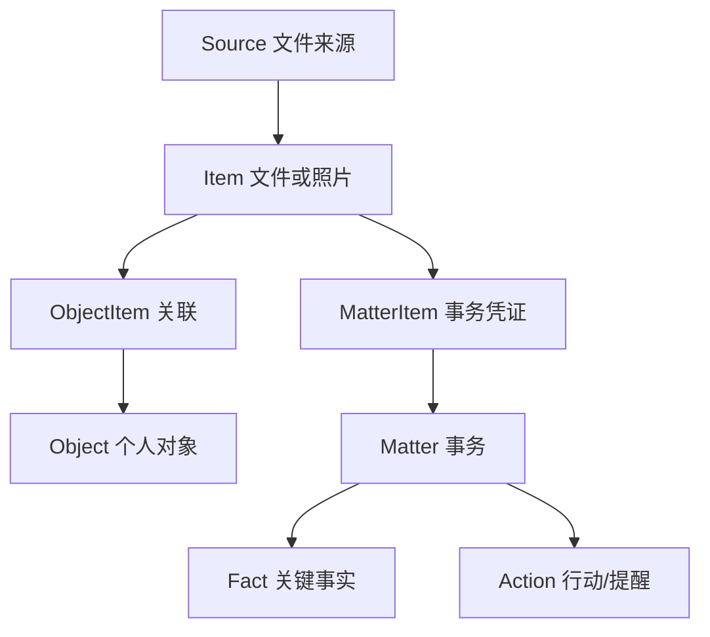

# 05 · 按能力增量增加的数据模型

> 一个 GRDB/SQLite 数据库。设计应让当前功能可用、后续可迁移；**不必在 M1 就创建所有表**。

## 1. 简化的核心关系



M1 只创建 Source、Item；M2 增加 Object、ObjectItem；M3 增加 Matter、MatterItem、Fact、Action。M5 再让 Item 支持 PhotoKit 的照片 ID。

### 明确暂不创建

不预建 `file_location`（一个 Item 多物理位置）、`managed_blob`（内容寻址归档）、`suggestion`（通用 AI 建议事件）、`notification_record`（通知状态机）、用户事件溯源表。需要时通过正式 SQLite migration 增加。

## 2. M1 数据表（最小可用）

### `source`

| 字段 | 含义 |
|---|---|
| `id` UUID | 资料来源唯一标识 |
| `name` String | 用户看到的文件夹名 |
| `bookmark_data` Data | 用户选定目录的安全作用域书签 |
| `enabled` Bool | 是否继续扫描来源 |
| `last_scanned_at` Date? | 最近成功完成时间 |
| `last_error` String? | 当前需要用户处理的具体错误代码/简要描述 |

来源权限是否有效以**当前访问结果**为准，不必维护多层互相覆盖的 `permission_state / scan_state / offline_state` 状态机。UI 的“扫描中”属于运行时任务状态，通常不需要持久化。

### `item`

| 字段 | 含义 |
|---|---|
| `id` UUID | 应用中单个文件条目的 ID |
| `source_id` UUID? | 所属来源，后期的照片/托管条目允许不同来源 |
| `relative_path` String? | 相对于已授权根目录的路径 |
| `title` String | 文件名/显示名 |
| `ut_type` String? | 系统文件类型 |
| `bytes` Int64? | 文件大小 |
| `modified_at` Date? | 修改时间 |
| `indexed_at` Date | 上次发现时间 |
| `is_available` Bool | 当前可访问与否；打开时可再次判定 |

- M1 唯一约束：`(source_id, relative_path)`，仅用于本地来源文件；不要使用文件名去重。
- 先不实现“两个相同字节文件自动合并成一个 Item”。它们是两条合法记录。
- 扫描刷新 upsert，不覆盖用户手动更改的 Object/Matter 关联。
- 扫描取消或失败时，不根据不完整结果将旧记录标记缺失。

### 来源移除语义

“停止管理来源”只是停扫、让该来源资料默认不出现在普通资料库。已关联到对象或事务的 Item 可以保留只读元数据和“原件不可用”状态，避免对象资料突然消失。清除残留的索引可以放到后续的数据管理操作，不需要第一轮就建一套复杂级联删除策略。

## 3. M2：对象及托管副本

### `personal_object`

`id`, `kind`（先 `device` / `other`）, `name`, `notes`, `created_at`, `updated_at`。

### `object_item`

`object_id`, `item_id`，两字段组合唯一；在对象详情支持关联、解绑。解绑不动源文件。

### 扩展 `item`

`managed_copy_path?`, `managed_sha256?`, `managed_at?`。

- 指向 Application Support 内已复制完成的相对路径；不能让数据库字段当作任意目标路径写外部位置。
- M2 无“归档池去重”，一份资料先按用户操作建立一份托管副本即可。
- 归档失败时不填写成功路径/校验哈希；原件不动。

## 4. M3：事务、事实和行动

### `matter`

`id`, `kind`（`order` / `warranty` / `contract` / `subscription`）, `title`, `status`（`active` / `completed`）, `object_id?`, `notes?`, `created_at`, `updated_at`。

### `matter_item`

`matter_id`, `item_id` 组合唯一；同一份凭证可属于多件事务。

### `fact`

`id`, `matter_id`, `key`, `value_text`, `value_type`（`text` / `date` / `amount`）, `state`（`candidate` / `confirmed`）, `source_item_id?`, `source_excerpt?`, `origin`（`ocr` / `model` / `user`）。

- `candidate` 不视为已核验事实；用户点击确认才改为 `confirmed`。
- 没有原文依据的用户手填 `origin=user`，这不是 AI 错误。
- 日期优先用 `YYYY-MM-DD` 保存日历日期，显示时按本地设置格式化；金额保留币种，避免浮点误差（用 Decimal/字符串）。
- 只保留对用户有价值的来源片段。M3 不需要通用多版本事实历史系统。

### `action`

`id`, `matter_id?`, `title`, `due_date?`, `remind_at?`, `state`（`needs_date` / `active` / `done` / `cancelled`）, `date_confirmed` Bool, `created_at`, `updated_at`。

提醒规则：

- `date_confirmed = false` 或 `remind_at = null` → 不安排系统通知。
- 创建/更新时使用 `action.<id>` 作为稳定系统通知 ID；完成/取消时移除这条 pending 通知。
- 数据库里的 Action 是事实来源，系统能否显示通知取决于用户授权；UI 单独显示授权结果，**不需要“分布式事务状态表”**。

## 5. M5 需要的扩展

`item.kind` 增加 `file / photo`；照片记录增加 `photo_local_identifier?` 和最低必要元数据。照片不必落盘复制。敏感状态初期只需 `sensitivity: normal / suspected / sensitive`，并在 OCR/FTS 前检查。

## 6. 搜索与索引

- M1 按 `title`, `relative_path`, `source_id`, `modified_at` 做 SQLite 查询；普通分页/限制查询行数即可。
- M4 为**明确允许**的非敏感文本增加 FTS5；不需要向量数据库。FTS 的 `MATCH` 输入要参数化，中文 1–2 字可以从标题 `LIKE` 简单 fallback 开始。
- 用户将文件改为敏感时删除对应正文索引；不把秘密明文留在应用日志中。若底层曾残留，不能宣传“取证级安全擦除”。

## 7. 迁移规则与测试

- 用 GRDB `DatabaseMigrator` 增加 M1→M2→M3 表与字段，不自动清空旧库。
- 每次做会改变数据结构的迁移，至少测试“空库创建”和“从上一个版本带两条记录升级”。不需要独立数据库版本管理平台。
- 业务操作以最少事务保护写入一致性，例如对象关联、事实确认；Vault 的文件写入与数据库不是同一个事务，先确保文件复制完成并校验，再记录成功。
- M6 备份包含 SQLite 一致性快照及 Vault。源文件只是索引的部分不包含在备份中；恢复时用户重新选择来源。

## 8. 供开发时检验的例子

一张订单写着「收货后 7 日内可退货」，只有购买日期 10 月 12 日：

```json
{
  "matter": {"kind": "order", "title": "耳机订单"},
  "facts": [
    {"key": "purchase_date", "value_text": "2026-10-12", "state": "confirmed", "origin": "user"},
    {"key": "return_policy", "value_text": "收货后 7 日内", "state": "candidate", "origin": "ocr"}
  ],
  "action": {
    "title": "确认退货截止日期",
    "due_date": null,
    "remind_at": null,
    "date_confirmed": false,
    "state": "needs_date"
  }
}
```

不根据购买日期臆造退货截止日。用户手动填入自己确认的具体日期后，才安排系统提醒。
